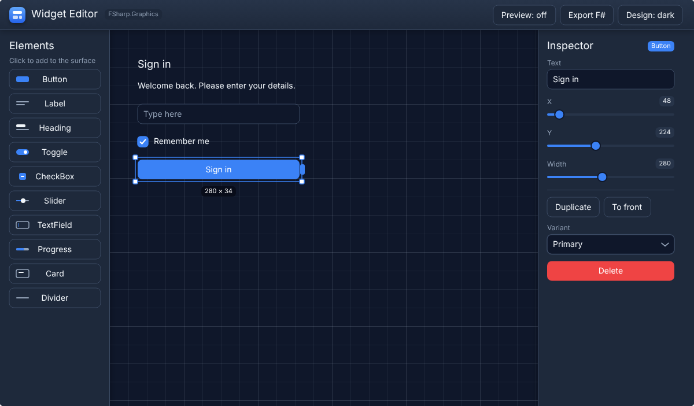

# fsharp-wasm-ide

Tools for building F# programs that run as WebAssembly GC, written in F# and compiled by
[fsharp-wasm](https://github.com/fsharp-wasm/fsharp-wasm). The first tool is the **widget editor**: a visual editor for
[`FSharp.Graphics`](https://github.com/fsharp-wasm/fsharp-wasm-graphics) widget layouts — a palette, a design surface, an inspector, a
preview and an export to F#. The whole interface is drawn by the module onto one `<canvas>`; JavaScript only forwards pointer, key
and size events ([`runtime/gfx.js`](https://github.com/fsharp-wasm/fsharp-wasm-runtime)).

```text
Model ──update──▶ Model          the TEA program of the editor        src/WidgetEditor          (library, .NET and Wasm)
Model ──View────▶ Scene          widgets of FSharp.Graphics.Widgets
Scene ──Resolve─▶ Emit ─▶ canvas FSharp.Graphics.Canvas + runtime/gfx.js   src/WidgetEditor.Browser  (the module: WidgetEditor.wasm)
scripted pointer + keys ─▶ model checked, PNGs written                  tests/WidgetEditor.Session (headless, software renderer)
```



Live: <https://fsharp-wasm.github.io/fsharp-wasm-runtime/demos/widget-editor/>

| path | what it is |
|---|---|
| `src/WidgetEditor` | the editor as a library: `Model` (nodes, selection, messages), `View`, `Export` (layout → F# source), `App` (hosts the TEA program) |
| `src/WidgetEditor.Browser` | the browser module: the exports `start`, `onResize`, `onPointer`, `onWheel`, `onKey`, `frame` that `runtime/gfx.js` calls |
| `tests/WidgetEditor.Session` | a scripted pointer and keyboard session through the real hit tester and key path, checked against the model |
| `tests/e2e/editor.mjs` | the compiled module driven in Chromium and judged by what the canvas shows |
| `web/index.html` | the page for development (`bash build/serve.sh`) |
| `lib/graphics`, `lib/runtime`, `lib/fsharp-wasm-core` | submodules: the widget library and canvas host, the JavaScript glue and test helpers, the F# base library |

## Build and run

```bash
git submodule update --init lib/graphics lib/runtime lib/fsharp-wasm-core
git -C lib/graphics submodule update --init lib/GlyphAura       # only for the session test (software renderer)
source build/env.sh                                              # FSHARP_WASM_CORE_DIR

dotnet build FSharp.Wasm.Ide.slnx -c Release                     # the editor under .NET
dotnet run --project tests/WidgetEditor.Session -c Release       # the scripted session; exit 1 if a check fails

# as WebAssembly GC: a compiler, and wasm-tools on the PATH
export FSHARP_WASM_BIN=/path/to/fsharp-wasm                      # the binary of a release, or
export FSHARP_WASM_DIR=/path/to/fsharp-wasm                      # a checkout (needs FSHARP_COMPILER, the patched fsc.dll)
bash build/build.sh                                              # dist/WidgetEditor.wasm
bash build/serve.sh                                              # http://127.0.0.1:8080/web/
npm install && node tests/e2e/editor.mjs                         # Chromium (Playwright)
```

The compiler is deliberately not a submodule: the siblings of fsharp-wasm take it as a release binary.

## Provenance and licence

The editor was written as the GUI builder demo of fsharp-wasm-graphics and moved here when that library's canvas host became a
library of its own (`FSharp.Graphics.Canvas`); the history up to the move is in that repository. Apache License 2.0 (see `LICENSE`,
`NOTICE`).
